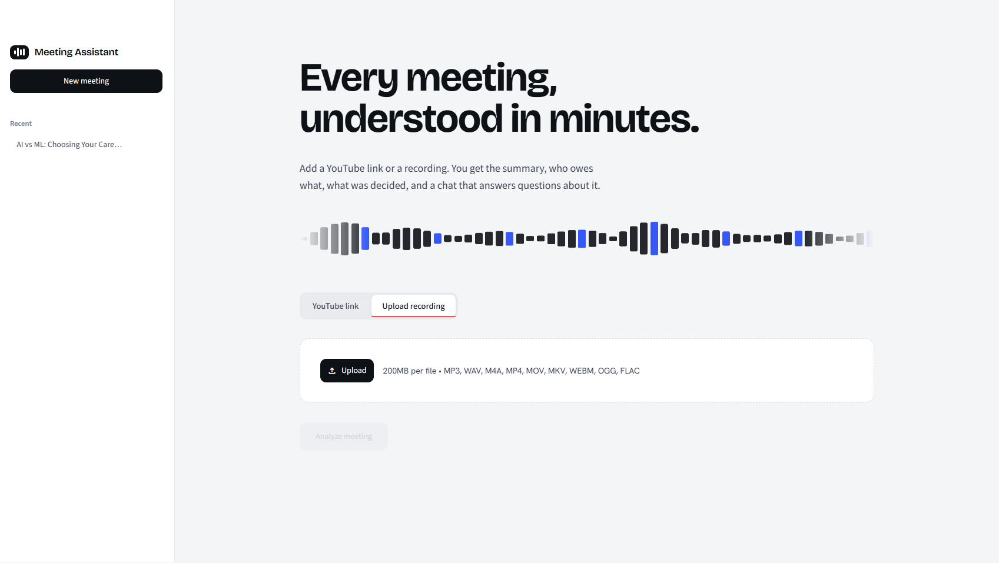

# MinutesAI — AI Meeting Assistant

An AI-powered meeting assistant built with Python and Streamlit that transforms YouTube videos and audio/video files into structured meeting insights. Transcribe conversations, generate summaries, extract action items and key decisions, and chat with your meeting using Retrieval-Augmented Generation (RAG).

# AI Video Assistant / MinutesAI



## Features

- **YouTube & File Input** — Process YouTube URLs and uploaded audio/video files.
- **AI Transcription** — Transcribe English audio using local OpenAI Whisper.
- **Meeting Summarization** — Generate concise, structured meeting summaries using an LLM.
- **Action Item Extraction** — Identify tasks, responsible owners, and deadlines when available in the conversation.
- **Key Decision Extraction** — Identify important decisions made during meetings.
- **Open Questions** — Extract unresolved questions and follow-up points.
- **AI Meeting Chat** — Ask questions about the meeting transcript using RAG.
- **PDF & TXT Export** — Download meeting reports for future reference.
- **Streamlit Interface** — Interact with the entire workflow through a web-based UI.

## How It Works

```text
YouTube URL / Audio / Video File
               |
               v
       Input Processing
               |
               v
      Audio Transcription
             Whisper
               |
               v
       Meeting Transcript
               |
               v
       LangChain Pipeline
               |
       +-------+--------+
       |       |        |
       v       v        v
    Summary  Action   Decisions
             Items
               |
               v
        Open Questions
               |
               v
      Transcript Chunking
               |
               v
   HuggingFace Embeddings
               |
               v
          ChromaDB
               |
               v
       Retrieval + LLM
               |
               v
        Meeting Q&A
               |
               v
       Streamlit UI
               |
               v
          PDF / TXT
```

## Tech Stack

| Technology | Purpose |
|---|---|
| Python | Core application logic |
| Streamlit | Interactive web interface |
| OpenAI Whisper | Local audio transcription |
| LangChain LCEL | LLM pipeline composition |
| Mistral AI | Meeting summarization, extraction, and Q&A |
| ChromaDB | Vector storage and similarity search |
| HuggingFace Embeddings | Local text embeddings |
| PyTorch | Deep learning framework used by Whisper and related models |

## Learning Reference

This project is part of my journey toward becoming an AI/ML and Generative AI engineer.

### 1. Audio Processing & Transcription
- Processing audio and video inputs.
- Understanding speech-to-text pipelines.
- Using local Whisper models for transcription.
- Exploring multilingual transcription with Sarvam AI.

### 2. LLM Applications
- Connecting an LLM API using LangChain.
- Designing prompts for structured meeting summaries.
- Extracting action items, decisions, and open questions.
- Separating application logic into reusable Python modules.

### 3. LangChain LCEL
- Building reusable LLM processing chains.
- Connecting prompts and language models.
- Organizing a multi-step AI pipeline.
- Handling model outputs for downstream processing.

### 4. Retrieval-Augmented Generation (RAG)
- Understanding document loading and text chunking.
- Generating embeddings with HuggingFace models.
- Storing vector representations in ChromaDB.
- Retrieving relevant transcript chunks.
- Building a question-answering workflow grounded in meeting content.

### 5. Vector Databases & Embeddings
- Understanding semantic similarity search.
- Exploring vector storage and retrieval.
- Learning how embeddings support contextual search.

### 6. Streamlit Application Development
- Building an interactive AI application.
- Handling file uploads and user inputs.
- Displaying processing states and AI-generated results.
- Exporting reports for offline use.


## Installation & Setup

### Prerequisites
- Python 3.10 or a compatible version supported by your dependencies.
- FFmpeg installed and available on your system PATH.
- A Mistral AI API key.


**Deployment note:** Whisper, PyTorch, and local embedding models can require substantial memory, disk space, and processing time. Install FFmpeg through Render's supported system-package configuration if required. Free instances have resource limits and may sleep when inactive. Local model downloads and ChromaDB data may need to be recreated after a restart or redeployment, so persistent storage or a hosted vector database may be necessary for long-term persistence.

## Future Improvements

- Live meeting transcription.
- Google Meet integration.
- Speaker diarization and timestamps.
- Searchable meeting history.
- Persistent storage for transcripts and reports.
- Calendar integration and automated follow-up reminders.

## Purpose

Built as a hands-on learning project to explore speech processing, LLM-powered information extraction, LangChain, embeddings, vector databases, RAG, and Streamlit deployment.

---

**MinutesAI — Turn conversations into actionable insights.**